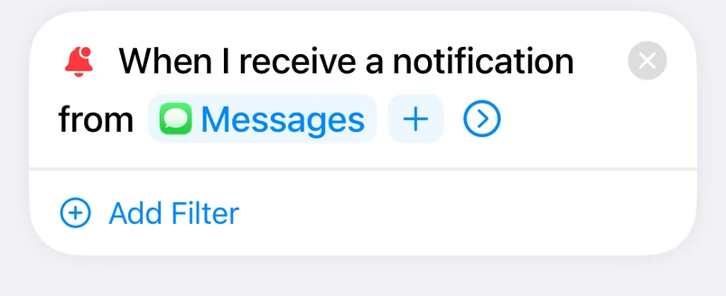
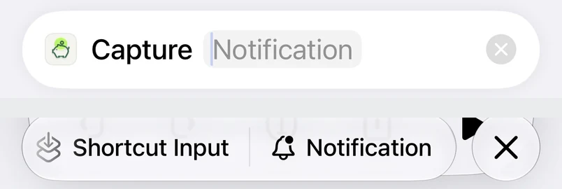

## Before you start

- An iPhone on **iOS 27 or later**
- **myMoney** from the App Store
- Your bank or e-wallet app with **payment notifications turned on** (check its own notification settings)

## Step by step

1. **Install myMoney and turn on auto-capture.** In the app, open auto-capture. It walks you through these same steps with screenshots, so you can follow along there.
2. **Create a notification automation.** Open **Shortcuts**, tap **Automation**, create a new automation, and choose **Notification**. The trigger reads *When I receive a notification from…*

   

3. **Pick your bank and e-wallet apps.** Tap the app next to *from* and add each bank and e-wallet app you pay with. Set the automation to **run immediately**, so it doesn't ask you each time.
4. **Add the Capture Notification action.** Search for **myMoney** in the actions list, add **Capture Notification**, and set its input to the **Notification** that triggered the automation.

   

5. **Make a payment and check To review.** Pay as usual. The payment shows up in **To review** with the amount, merchant, category and wallet filled in. Confirm it with one tap, or turn off review to let captures save on their own.

## Tips

- **One automation, several banks.** You can add more apps to the same automation later.
- **Card digits pick the wallet.** Add the last 3–4 digits of each card to its wallet in myMoney, and payments land in the right place.
- **Your first 3 captures are free.** After that, [Bánh Xèo](/pricing/) reads every payment. Payments that arrive before you buy wait in To review.
