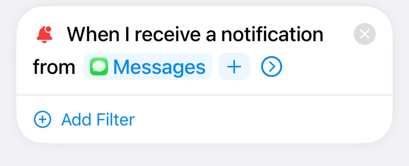
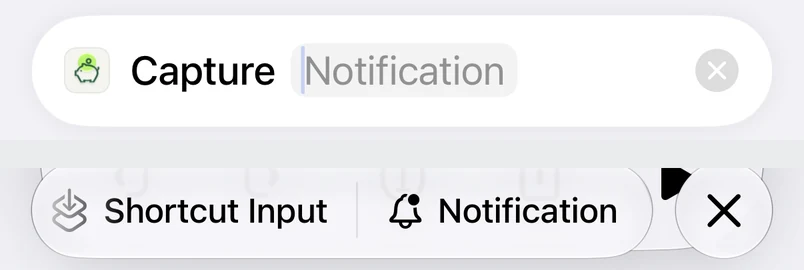

## Cần chuẩn bị

- iPhone chạy **iOS 27 trở lên**
- **myMoney** từ App Store
- App ngân hàng hoặc ví điện tử đã **bật thông báo giao dịch** (xem trong cài đặt thông báo của app đó)

## Từng bước

1. **Cài myMoney và bật Tự ghi.** Trong ứng dụng, mở phần Tự ghi. Ứng dụng hướng dẫn đúng các bước dưới đây kèm ảnh, bạn có thể làm theo ngay ở đó.
2. **Tạo lệnh tự động theo thông báo.** Mở **Phím tắt**, chọn **Tự động hóa**, tạo lệnh tự động mới và chọn **Thông báo**. Trình kích hoạt có dạng *Khi tôi nhận được thông báo từ…*

   

3. **Chọn app ngân hàng và ví điện tử.** Chạm vào tên app bên cạnh *từ* và thêm từng app ngân hàng, ví điện tử bạn dùng. Đặt lệnh tự động **chạy ngay** để không phải xác nhận mỗi lần.
4. **Thêm tác vụ Capture Notification.** Tìm **myMoney** trong danh sách tác vụ, thêm **Capture Notification** và chọn đầu vào là **Thông báo** đã kích hoạt lệnh.

   

5. **Thanh toán và kiểm tra mục Cần xem lại.** Thanh toán như mọi khi. Khoản chi hiện trong **Cần xem lại** với số tiền, nơi chi, danh mục và ví đã điền sẵn. Xác nhận bằng một chạm, hoặc tắt chế độ duyệt để ứng dụng tự lưu.

## Mẹo

- **Một lệnh tự động, nhiều ngân hàng.** Bạn có thể thêm app vào cùng lệnh tự động sau này.
- **Số cuối thẻ chọn đúng ví.** Thêm 3–4 số cuối của từng thẻ vào ví tương ứng trong myMoney.
- **3 lần tự ghi đầu tiên miễn phí.** Sau đó, [Bánh Xèo](/vi/bang-gia/) đọc mọi giao dịch. Thông báo đến trước khi mua vẫn chờ trong mục Cần xem lại.
